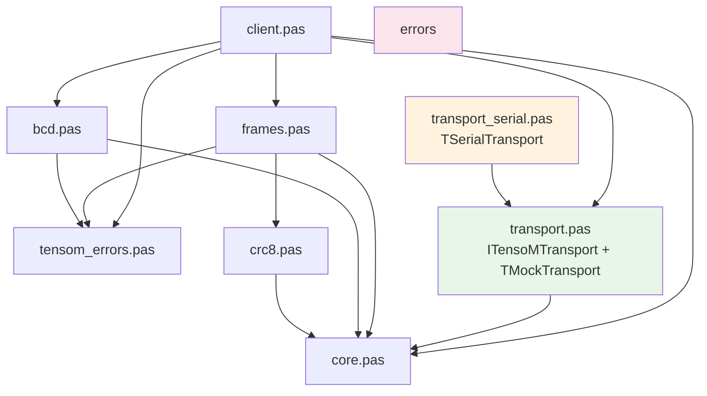

# TensoMLib

Библиотека на Free Pascal / Lazarus для работы с весовыми приборами Тензо-М по протоколу Тензо-М (RS-232 / RS-485).

## Возможности

- Низкоуровневый кодек кадров протокола Тензо-М (кодирование скорости, длины, CRC-8, байт-стаффинг FF→FF FE)
- Иерархия исключений по семантике ошибок (транспорт, таймаут, CRC, кадр, устройство, протокол)
- Модульный транспортный слой: интерфейс `ITensoMTransport`, мок `TMockTransport` для тестирования, реализация `TSerialTransport` для COM-порта (LazSynaSer + WinAPI DCB fallback для нестандартных USB-COM драйверов)
- Мок-сервер прибора: `TMockDeviceTransport` (виртуальный прибор — сам разбирает запросы и отвечает по протоколу), `TMockBus` (мультиадресная шина из нескольких приборов) и консольный `tenso_mock_server` (реальный COM-порт через виртуальную пару, несколько приборов на шине, клавиатурное управление весом)
- Высокоуровневый клиент `TTensoMDevice` с автоматическими ретраями, настраиваемой политикой повторов, логированием кадров и автоопределением режима CRC
- Полный набор команд протокола: вес, тарирование, конфигурация, серийный номер, дискретные входы/выходы, индикаторы, счётчики, калибровка, дозирование, инициативная передача
- Функции сканирования доступных COM-портов (Windows: QueryDosDeviceA, Linux: /dev/ttyS*, /dev/ttyUSB*, /dev/ttyACM*)
- Учёт модельной специфики ТВ-003/05Н и ТВ-003/05Д: запрос идентификации FDh,
  байт N в запросе кода АЦП (05Д), бит «Нетто» D5 в CON веса (05Д);
  мок-сервер умеет эмулировать набор команд обеих моделей (`-model`)
- Юнит-тесты через FPCUnit (CRC, BCD, кадры, транспорт, клиент — включая ретраи, логирование, иерархию исключений)
- Интеграционная тестовая утилита с XML-отчётом
- Пакет времени выполнения для Lazarus (`tensom_rt.lpk`)
- Расширяемая архитектура

## Структура

```
src/
  core.pas              — типы, константы COP, записи (TWeightData, TParsedFrame, TErrorInfo),
                           вспомогательные функции (HexBytes, ErrorDescription)
  tensom_errors.pas     — иерархия исключений:
                           ETensoMError
                             ├── ETensoMTransportError
                             │     └── ETensoMTimeoutError
                             ├── ETensoMFrameError
                             │     └── ETensoMCRCError
                             ├── ETensoMDeviceError
                             └── ETensoMProtocolError
                                   └── ETensoMAddressMismatchError
  crc8.pas              — CRC-8, полином $69 (CRCUpdate / MakeCRC / VerifyCRC)
  bcd.pas               — упакованный BCD little-endian: DecodePackedBCD, EncodePackedBCD, DecodeWeight
  frames.pas            — BuildFrame, TFrameCollector (конечный автомат), ParseFrame
  transport.pas         — ITensoMTransport, TMockTransport, BaudRateToValue / BaudRateToCode
  transport_serial.pas  — TSerialTransport (LazSynaSer + WinAPI DCB fallback), ScanSerialPorts
  client.pas            — TTensoMDevice (фасад): вес, тарирование, конфигурация,
                           серийный номер, статус, дискретные В/В, индикаторы,
                           счётчики, калибровка, АЦП, дозирование,
                           инициативная передача, отображение сообщений,
                           автоопределение CRC, ретраи, протоколирование кадров
  tensom_rt.lpk         — пакет времени выполнения Lazarus

tests/
  test_crc.pas          — тесты CRC-8 (векторные, MakeCRC, VerifyCRC, краевые)
  test_bcd.pas          — тесты BCD-кодирования/декодирования и декодирования веса
  test_frames.pas       — тесты построения, сбора и разбора кадров
  test_transport.pas    — тесты интерфейса транспорта и мока
  test_client.pas       — тесты клиента: вес, тарирование, конфигурация, ошибки,
                           ретраи, логирование, иерархия исключений
  run_tests.lpr         — консольный запускатор юнит-тестов (FPCUnit)
  run_tests_gui.lpr     — GUI-запускатор юнит-тестов (FPCUnit)
  integration/
    tensotest.lpr       — утилита тестирования реального прибора (XML-отчёт + лог кадров)

mock/
  mock_server.pas       — TMockDeviceTransport: виртуальный прибор (сам разбирает
                           запросы и отвечает по протоколу) + TMockBus:
                           мультиадресная шина из нескольких приборов
  tenso_mock_server.lpr — консольный мок-сервер на реальном COM-порту (виртуальная
                           пара com0com/socat): `-a 1,3,5` — несколько приборов
                           на одной шине, клавиатурное управление весом,
                           имитация ошибок EEh/FDh, автоопределение CRC
  test_mock_server.pas  — тесты мока через полный стек TTensoMDevice

demo/
  console/
    demo.lpr            — консольный пример: сканирование портов, подключение,
                           автоопределение CRC, серийный номер, конфигурация, 5 чтений веса
  monitor/
    checktensom.lpr     — GUI-программа (Lazarus) для тестирования по протоколу Тензо-М:
                           подключение, сканирование портов, вес (брутто/нетто),
                           серийный номер, статус, адрес, индикаторы, АЦП,
                           дискретные В/В, калибровка, весовые точки,
                           спец. параметры, инициативная передача, лог-файл
    mainform.pas        — основная форма монитора
    mainform.lfm        — ресурсы формы
```

### Иерархия зависимостей



## Быстрый старт

```pascal
uses
  transport_serial, client;

var
  Tr: TSerialTransport;
  Dev: TTensoMDevice;
  W: TWeightData;
begin
  Tr := TSerialTransport.Create;
  try
    Tr.Connect('/dev/ttyUSB0', 9600);
    Dev := TTensoMDevice.Create(Tr, 1);
    try
      Dev.ResponseTimeout := 1000;

      { Автоопределение режима CRC (без/с CRC) }
      Dev.AutoDetectCRC;

      W := Dev.GetBruttoWeight;
      WriteLn(Format('БРУТТО: %.3f кг, стабилен: %s',
        [W.Weight, BoolToStr(W.Stable, 'да', 'нет')]));

      W := Dev.GetNettoWeight;
      WriteLn(Format('НЕТТО: %.3f кг', [W.Weight]));

      { Тарирование }
      Dev.Tare;
    finally
      Dev.Free;
    end;
  finally
    Tr.Disconnect;
    Tr.Free;
  end;
end;
```

## Сборка

### Юнит-тесты (консольные)

```bash
# Из каталога tests/: вывод в ../lib (в .gitignore), исходники — ../src
cd tests
fpc -MObjFPC -Sh -FE../lib -FU../lib -Fu../src run_tests.lpr
../lib/run_tests --format=plain
```

Пути `in '../src/*.pas'` в тестах разрешаются относительно каталога
запуска компилятора — собирайте из `tests/`. Вывод направлен в `lib/`,
чтобы не засорять `src/` файлами .ppu/.o (в IDE это приводит к ошибке
«Ambiguous unit found»).

### Консольное демо

Для сборки с реальным портом в пути юнитов нужны исходники LazSerial
(при установке через OPM: `%LocalAppData%\lazarus\onlinepackagemanager\packages\LazSerial`):

```bash
fpc -MObjFPC -Sh -FElib -FUlib -Fusrc -Fu"<путь к LazSerial>" demo/console/demo.lpr
./lib/demo
```

### GUI-монитор

Открыть `demo/monitor/checktensom.lpi` в Lazarus и собрать (требуется пакет LazSerial).

### Пакет Lazarus

Открыть `src/tensom_rt.lpk` в Lazarus → «Установить». Библиотека будет доступна в проектах через менеджер пакетов.

### Интеграционные тесты (с реальным прибором)

```bash
fpc -MObjFPC -Sh -FElib -FUlib -Fusrc -Fu"<путь к LazSerial>" tests/integration/tensotest.lpr
./lib/tensotest /dev/ttyUSB0 1 3000
# или на Windows:
# ./lib/tensotest COM3 1 3000
```

Результат: XML-отчёт и лог кадров в текущем каталоге.

### Мок-сервер прибора (без железа)

Программа `tenso_mock_server` эмулирует прибор на реальном COM-порту
через виртуальную пару портов (Windows: com0com, Linux: socat) — удобно
для ручной проверки потребителя (например, KD_MES) без весов:

```bash
# Windows: COM10 <-> COM11 (com0com)
tenso_mock_server -p COM10 -a 1,3,5 -w 123.4 -stable
# -a 1,3,5 — ТРИ виртуальных прибора на одной шине (SN = база+i);
# клавиатура: стрелки — вес, s — стабильность, z — ноль, ? — справка
```

## CI/CD

GitHub Actions (`.github/workflows/`):

- **tests.yml** — на каждый push в `main`/`master` и PR: сборка и прогон юнит-тестов
  (`tests/run_tests` и `mock/test_mock`, FPCUnit, Ubuntu) + контрольная сборка
  `tenso_mock_server` под Linux. XML-отчёты тестов прикладываются к прогону как артефакты.
- **release.yml** — на пуш тега `v*`: проверка соответствия тега версии пакета
  `src/tensom_rt.lpk`, сборка `tenso_mock_server` (linux64 + win64), GitHub Release
  с автогенерированными заметками и бинарниками мок-сервера.

Порядок выпуска релиза:

```bash
# 1. Поднять версию пакета в src/tensom_rt.lpk (Major/Minor/Release/Build), закоммитить
# 2. Тег — строго v<версия пакета> (хвостовые .0 можно опускать: Major=1 Minor=0 -> v1.0)
git tag v1.0 && git push && git push origin v1.0
```

Тег, не совпадающий с версией lpk, релиз заблокирует (в логе будет указана ожидаемая версия).
Бинарники прикладываются автоматически: `tenso_mock_server_linux64`, `tenso_mock_server_win64.exe`.

## API клиента (TTensoMDevice)

### Весовые измерения

| Метод | COP | Описание |
|-------|-----|----------|
| `GetBruttoWeight: TWeightData` | C3h | Вес брутто (значение, стабильность, перегруз, знак, режим «Нетто» (05Д), запятая) |
| `GetNettoWeight: TWeightData` | C2h | Вес нетто |
| `Tare` | C0h | Обнуление / тарирование |

### Конфигурация прибора

| Метод | COP | Описание |
|-------|-----|----------|
| `GetDeviceConfig(out MaxWeight, Division, DecimalPlaces, Mode, ADCFreqCode, VSEN, FilterCode)` | C1h | Параметры прибора: макс. вес, дискретность, режим (БРУТТО/НЕТТО), частота АЦП, VSEN, фильтр |
| `SetBaudRate(RateCode)` | DBh | Установка скорости обмена (переводит и прибор, и COM-порт) |
| `SetFilter(FilterCode)` | DAh | Полоса пропускания фильтра |
| `SetADCFrequency(FreqCode)` | D9h | Частота обновления АЦП |

### Системная информация

| Метод | COP | Описание |
|-------|-----|----------|
| `GetSerialNumber: Cardinal` | A1h | Серийный номер (3 байта) |
| `GetDeviceVersion: string` | FDh | Тип устройства и версия ПО — строка «NAME Vers» (например `TB003/05D 10.13AX`). Прямой запрос FDh поддерживает ТВ-003/05Д; остальные приборы отвечают FDh с той же строкой на неизвестные команды |
| `GetSystemStatus: Byte` | BFh | Байт состояния весоизмерительной системы |
| `SetNetworkAddress(NewAddr)` | A0h | Присвоение нового сетевого адреса ($01..$9F). Ответ принимается и со старого, и с нового адреса; после подтверждения клиент переключается на новый адрес |

### Дискретные входы/выходы

| Метод | COP | Описание |
|-------|-----|----------|
| `GetDiscreteInputs: TBytes` | C4h | Состояние дискретных входов |
| `GetDiscreteOutputs: TBytes` | C5h | Состояние дискретных выходов |
| `SetDiscreteOutputs(Value)` | D0h | Установка сигналов на выходах |

### Индикаторы и клавиатура

| Метод | COP | Описание |
|-------|-----|----------|
| `GetIndicators(out Text, out Flags)` | C6h | Текст и флаги индикатора |
| `GetProductCode: string` | C7h | Введённый код продукта |

### Счётчики

| Метод | COP | Описание |
|-------|-----|----------|
| `GetCounter(CounterNum): TBytes` | C8h | Счётчик №0..9 |

### Калибровка и диагностика

| Метод | COP | Описание |
|-------|-----|----------|
| `GetCalibrationParams: TBytes` | CBh | Параметры калибровки |
| `GetADCCode(AMode): TBytes` | CCh | Код АЦП. AMode: 0 — запрос без байта данных (общий протокол, по умолчанию); 1 — текущий код, 2 — приращение кода (байт N в запросе, ТВ-003/05Д). Байты ответа — как есть, младшие первыми |

### Дозирование

| Метод | COP | Описание |
|-------|-----|----------|
| `DosingControl(Cmd)` | DFh | Управление дозированием (стоп/старт/пауза/продолжение) |

### Инициативная передача

| Метод | COP | Описание |
|-------|-----|----------|
| `StartInitTransmit(COP)` | CEh | Запуск инициативной передачи |
| `StopInitTransmit` | CFh | Остановка инициативной передачи |

### Отображение

| Метод | COP | Описание |
|-------|-----|----------|
| `DisplayMessage(DeviceNum, Msg)` | D2h | Вывод символьного сообщения на индикатор |
| `SetDisplayWeightMode` | CDh | Перевод прибора в режим индикации веса |

### Диагностика

| Метод | Описание |
|-------|----------|
| `AutoDetectCRC: Boolean` | Автоопределение режима CRC: пробует без CRC, затем с CRC. Меняет свойство `UseCRC`. На время детекта ретраи (`RetryCount`/`RetryDelayMS`) глушатся |

### Свойства

| Свойство | Тип | Описание |
|----------|-----|----------|
| `Address` | Byte | Сетевой адрес прибора (только чтение) |
| `UseCRC` | Boolean | Включение/выключение CRC в кадрах |
| `ResponseTimeout` | Cardinal | Таймаут ожидания ответа, мс (по умолчанию 700) |
| `RetryCount` | Integer | Количество повторов при транспортных ошибках, ошибках кадров и ответе с чужого адреса (ETensoMAddressMismatchError: на шине это обычно поздний ответ соседа; Flush перед повтором гасит хвост линии). Ошибки прибора (EEh), неподдерживаемые команды (FDh) и semantic-ошибки **не** повторяются |
| `RetryDelayMS` | Cardinal | Пауза между повторами, мс (по умолчанию 0) |
| `OnFrameLog` | TFrameLogEvent | Callback для логирования каждого отправленного и полученного кадра (hex-строка) |
| `LastRequestHex` | string | Hex-дамп последнего отправленного кадра |
| `LastResponseHex` | string | Hex-дамп последнего полученного кадра |
| `LastError` | string | Текст последней ошибки |

## Модельная специфика: ТВ-003/05Н и ТВ-003/05Д

Обе модели говорят по стандартному протоколу Тензо-М (тот же кадр,
байт-стаффинг, CRC-8 $69), но поддерживают **разные наборы команд**
(см. руководства по эксплуатации). Команда вне набора модели — прибор
отвечает `FDh`, клиент бросает `ETensoMProtocolError`.

| Команда | ТВ-003/05Н | ТВ-003/05Д | Примечание |
|---------|------------|------------|------------|
| `C0h` обнуление/тарирование | ✔ | ✔ | |
| `C2h` вес нетто | ✔ | ✔ | у 05Д бит D5 CON = режим «Нетто» (`TWeightData.NettoMode`) |
| `C3h` вес брутто | ✔ | ✔ | |
| `C1h` конфигурация | ✔ | — | |
| `C8h` счётчики | ✔ (`NW=06` — максимум нагрузки) | — | |
| `CEh` | ✔ (обнуление тары) | — | |
| `CCh` код АЦП | — | ✔ (в запросе байт N: 1 — текущий, 2 — приращение) | `GetADCCode(AMode)` |
| `FDh` идентификация | (ответ на неизвестную команду) | ✔ (прямой запрос) | `GetDeviceVersion` |

Прочие отличия 05Д (справочно): скорости 4,8–115,2 кбод (без 2400),
сетевой адрес 1–127, 1–2 стоп-бита, позиция запятой в CON 0–7,
дополнительно поддерживается MODBUS RTU (вне рамок библиотеки).

`AutoDetectCRC` пробирует командой `C3h`, которая есть у обеих моделей, —
работает независимо от модели.

### Проверка потребителя против 05Д без железа

Мок-сервер эмулирует набор команд конкретной модели: неподдерживаемые
команды получают ответ `FDh` со строкой идентификации, `C2h` у 05Д несёт
бит D5, `CCh` различает N=1/N=2:

```bash
tenso_mock_server -p COM10 -a 1 -model 05d -w 123.4 -stable
# -model: uni (весь протокол, по умолчанию) | 05n | 05d
# 05d → идентификация "TB003/05D 10.13AX"
```

## Потокобезопасность

Библиотека **не синхронизирована**: один транспорт (COM-порт) должен
опрашиваться одним потоком. Для мультиадресной шины создайте один
`TTensoMDevice` на адрес прибора и опрашивайте их последовательно из
нити-владельца порта (так делает KD_MES: `TTensoMScaleBus` с видами
`TTensoMScale` на общий `TSerialTransport`).

Жизненный цикл: интерфейс транспорта CORBA (без подсчёта ссылок) —
транспорт освобождается **после** `TTensoMDevice.Free`.

## Зависимости

- Free Pascal Compiler >= 3.2
- Lazarus >= 3.0
- Пакет LazSerial (LazSerialPort) — только для работы с реальным COM-портом.
  Без него доступны все модули кроме `transport_serial`, а тесты работают через `TMockTransport`

## Лицензия

MIT (c) 2026, Renat Suleymanov, https://github.com/Al-Muhandis